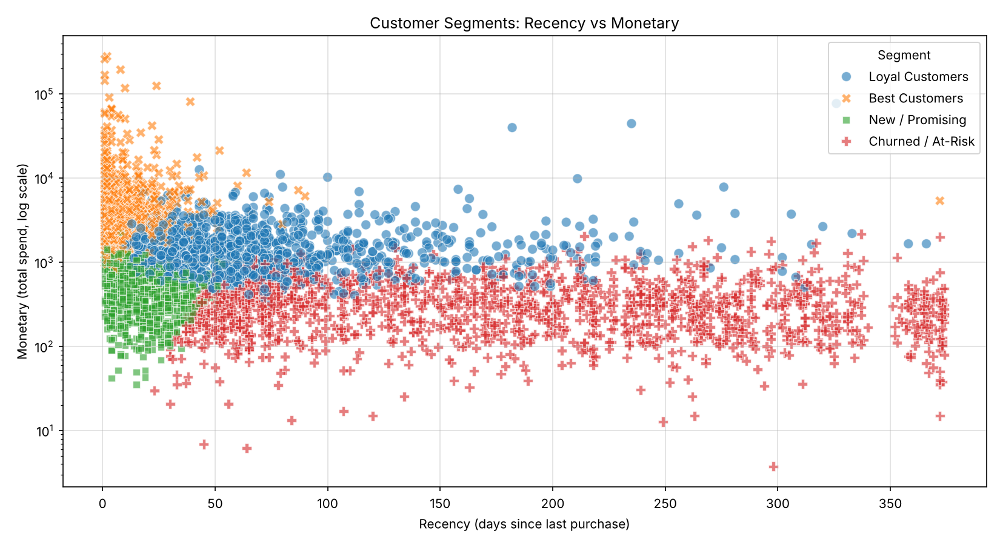
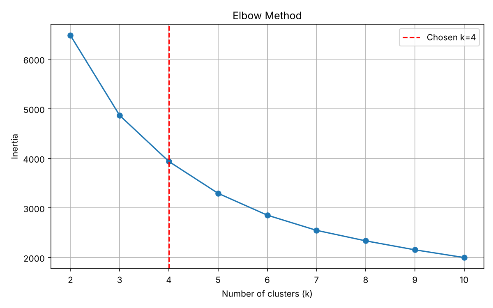

# Customer Segmentation with RFM + K-Means

I built this to practice customer segmentation on a real retail dataset. It groups customers by how recently they bought, how often they buy, and how much they spend (RFM), and then lets you drop in a new customer, or a randomly generated one, and see which segment they fall into.

## What it does

1. **`train_model.py`** cleans the Online Retail data, builds RFM features per customer, log-transforms and scales them, and trains K-Means (k=4, picked using the elbow plot and silhouette scores).
2. **`predict_customer.py`** generates random customers and assigns each one to a segment. You can also pass your own Recency / Frequency / Monetary values.

## Setup

```bash
pip install -r requirements.txt
```

The trained model is already included in `models/rfm_kmeans.joblib`, so you can skip straight to the prediction step below. If you want to retrain it, download the Online Retail dataset (UCI Machine Learning Repository / Kaggle) and put it at `data/online_retail.csv`. I haven't included the dataset in the repo because of the file size.

## Run it

```bash
# 1. train and save the model
python train_model.py --data data/online_retail.csv

# 2. random customers
python predict_customer.py --n 5 --seed 42

# 3. your own customer
python predict_customer.py --recency 5 --frequency 12 --monetary 4200
```

Example output:

```
 Recency  Frequency  Monetary            Segment  Distance_To_Centroid
      63          3   2159.92    Loyal Customers                  0.44
      61         13   5804.75     Best Customers                  1.50
      65          1    184.17  Churned / At-Risk                  0.71
```

## Results

Trained on 4,338 customers (after removing rows with no CustomerID and cancelled or invalid orders):

| Segment | Customers | Avg recency (days) | Avg orders | Avg spend (£) |
|---|---|---|---|---|
| Best Customers | 716 | 12 | 13.7 | 8,074 |
| Loyal Customers | 1,173 | 71 | 4.1 | 1,803 |
| New / Promising | 837 | 18 | 2.2 | 552 |
| Churned / At-Risk | 1,612 | 183 | 1.3 | 343 |




I went with k=4 because it gives segments that are easy to act on. The silhouette score is actually highest at k=2 (0.43 vs 0.34 at k=4), so k=4 is a business-interpretability choice, not the statistically tightest one.

## How the random customers are made

Generating three independent random numbers would give unrealistic customers (e.g. 1 order but huge spend, every time). Instead I fit a multivariate normal on the log-transformed training data and sample from it, so the generated customers keep the same relationships between R, F and M as the real ones.

## Things worth knowing

- This is **unsupervised** clustering. "Prediction" here means assigning a new customer to the nearest segment, not forecasting something like churn or future spend.
- K-Means numbers its clusters arbitrarily, so segment names (Best, Loyal, New/Promising, Churned/At-Risk) are assigned from the cluster centres in `name_segments()`. Check `outputs/segment_profiles.csv` to make sure the names make sense for your run.
- Random customers are synthetic, so they're good for demos and testing, not for drawing business conclusions.

## Ideas for next steps

- Compare with a supervised churn model
- Wrap `predict_customer.py` in a small Streamlit app
- Try other clustering methods (e.g. Gaussian Mixture) and compare

## Tech

Python, pandas, NumPy, scikit-learn, matplotlib, seaborn, joblib
